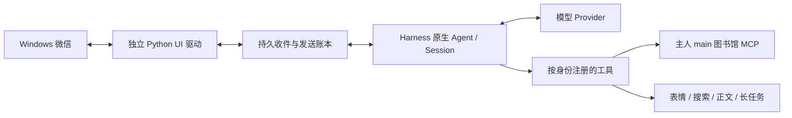

# 小千微信 · Harness Native

让 Harness 直接承载小千的模型、持久会话和工具。微信只是消息入口和发送工具，Python 驱动只负责桌面操作；不再通过独立 Brain、总 worker 或一次性 headless 转发重复调度模型。

本仓库是一次**不含用户数据的公开源码快照**，基础提交为 `31d600923536d01df6702a344ae8b9abf2dc2235`。它包含与该次上线相同代际的兼容驱动，以及尚未切入生产的新驱动源代码。公开快照不等于已在你的机器上完成真实微信验收。

## 架构



- 每个微信会话对应独立的持久 Agent Session；恢复使用原生 `resumeSessionId`。
- 入站先持久化到核心，再 ACK。稳定消息身份按会话保存，切窗不能把旧消息变成新指令。
- UI 串行执行；模型推理、下载和后台任务不占用 UI 队列。
- 每次发送使用稳定 operation ID。发送后结果不明时保留 `unknown`，不自动重发；普通单条未知状态不能封锁整个会话。
- 主人认证、Agent 绑定、群工具限制在程序中执行，不依赖模型自觉。群消息和网页、文档内容都不能授予主人权限。

## 能力与真实边界

| 能力 | 当前实现 / 限制 |
|---|---|
| 主人私聊、指定群 | 原生持久 Agent、会话隔离、群语境参与、停/少说/恢复；不是所有群自动开放 |
| 人格 | 从私有状态目录加载每会话人格，动态组装系统提示；本库不附原人格 |
| 防重复与恢复 | 会话级有序快照、入站 ACK、发送状态账本；有歧义时延迟识别，不按正文永久去重 |
| 表情库 | 原字节存储、审核、描述/标签检索、旧库非破坏迁移；截图仅是静态预览 |
| 网上图片入库 | 主人限定的公开 URL 下载、重定向/IP 检查、大小与总时限约束，新资源进入待审核 |
| 动画 | 已有 GIF/APNG/WebP 原文件保留；兼容已确认的旧文件尾注格式。尚未证明能自动抓取微信原动画，也不把发送端回显当接收端播放验收 |
| 搜索与读正文 | 独立 Bing/DDG 搜索及公开网页正文读取；搜索摘要不等于全文。超时、限流、付费墙、CAPTCHA 会明确失败；不绕过访问限制 |
| main 图书馆 | 主人限定的 MCP 检索/读取与受约束写入接口；默认回环 `127.0.0.1:8767/mcp`，固定 main 项目。私密库不能接入社交 Agent |
| 聊天长期记忆 | 当前会话、带证据的长期聊天记忆、原图书馆是三层不同存储；未确认发送不能记作已经送达 |
| 定时主动检查 | 主人高峰随机 18–32 分钟、低谷随机 3–7 分钟；睡眠优先，不补发过期任务，群定时默认关闭。模型可以 skip；决策有局部超时 |
| 长任务 | 持久 task ID、立即返回、后台状态/进度/取消/结果、重启对账；未知执行不自动重跑。模型子任务的工具权限仍受限，不等同任意电脑代理 |
| API 余额 | 仅官方 DeepSeek provider 的固定只读余额入口，认证留在内部；转发商 key 不向官方转发。不是充值/支付工具 |
| 插件/MCP 管理 | 原生完整列表已通过真实 ToolRuntime 边界验收，修复了可选字段含 undefined 的序列化错误；保留真实条目，不以空数组兜底。安装/启用及新 MCP 的具体操作通过宿主确认，不是未知源全自动安装 |
| 项目文件 | 专用工作目录内受约束读写、原子备份、结构化 list/stat/sha256，含 Agent 动态撤权 |
| 任意 shell | **未启用**。结构化 `owner_command` 不是任意 PowerShell；尚无已批准并验收的通用 shell 隔离边界 |
| 微信附件 | TXT/DOCX 解析与消息绑定接口存在；真实文件卡下载入口尚未闭环，不能声称任意微信附件已可读取 |
| 上下文轮换 | 成本影子观测、归档读回与切换事务代码存在；**自动轮换关闭**。缺少可靠全文 token 估计时保持 indeterminate，不把字节数当预计 token |
| 生图/其他模型 | 可选能力，未配置即不可用；不随安装自动部署服务或购买 API |
| 黑名单 | 不迁移；主人认证、群权限和私库隔离仍保留 |

网页搜索没有付费 Search/Fetch API，并不代表使用零成本：把正文送给模型仍消耗 token。主动检查、长模型任务同样可能产生模型费用。

原生 `pluginMarket` 与已有社区索引是不同来源：原生市场未挂载，不能据此报告“没有任何市场源”。`owner_plugins indexes` 分别返回两者，并明确第三方属性。`owner_mcp discover` 只枚举其管理范围；独立的 `xiaoqian_library_*` 适配器不在此表，管理表为空也不能推断图书馆断连，应使用图书馆自身 health 工具。

## 目录

```text
src/          Harness 插件、会话、工具、权限、记忆、主动检查
driver/       新代际驱动 RPC 与客户端（迁移前隔离验收）
adapter/      新代际 Windows 适配器（非 macOS 适配器）
compat/       与基础上线版本同代际的驱动及必要源代码
vendor/       独立模块与保留的第三方声明
tools/        配置渲染、受控 worker
tests/        合成消息、fake 驱动与原生契约测试
docs/         配置模板、发布及来源说明
SOURCE.json   源码基础和兼容驱动指纹，不含生产路径
```

不要把 `compat` 的稳定身份状态直接交给新 `driver`。新旧身份格式、完整文本升级和历史基线需要单独迁移验收，不能通过清空数据库“解决”重复消息。

**跨桌面迁移尚有未闭环的身份风险。** 即使保留了账本，新桌面的 UI RuntimeId 也可能重新分配；已有 `uia-row-v2` 且 `bootstrapped=true` 的状态不能证明旧可见消息在新桌面仍会被正确识别。换服务器、换交互桌面或更换驱动后，必须保持 paused，先验证身份基线与安全恢复机制；未经验证不得接收并自动回复。不能清账本、重放历史或只按正文去重来绕过此门槛。代码发布、备份可读和 fake 用例通过均不等于跨桌面迁移验收通过。

## Windows 服务器依赖

已验证的依赖代际：Node.js 24、Python 3.12、DeepSeek Harness `0.2.1-rc.4`、Windows 微信 4.1 UI。Python 依赖见 `requirements-windows.txt`（uiautomation、comtypes、Pillow）。包升级或微信 UI 更新可能改变接口，先在隔离副本验证。

真实 UI 需要微信所在的**同一个交互登录会话与桌面**。SSH 服务所在的 Session 0 不等于微信桌面。Harness 本身是 Node CLI Web host，浏览器是管理前端；关闭浏览器不等于停止宿主。某台机器 RDP 断开后可继续操作，不代表锁屏、注销、会话切换或所有云服务器都可用，须针对部署环境验收。

先确认现有 Python 解释器及已装包，再决定是否创建独立虚拟环境；不要给生产虚拟环境盲目升级依赖。仓库不包含微信、模型权重、Harness 私有配置或 API key。

## 空白环境安装

以下路径是**示例路径**，请替换为自己的独立目录。真实状态、人格、库、附件和日志都放在 Git 工作树之外。

```powershell
$Repo = 'C:\Apps\xiaoqian-weixin'
$HostRoot = 'C:\Apps\Harness'
$Private = 'C:\AppData\Xiaoqian'
$Python = 'C:\Python312\python.exe'

New-Item -ItemType Directory -Force $HostRoot, $Private | Out-Null
& $Python -m venv "$Private\venv"
& "$Private\venv\Scripts\python.exe" -m pip install -r "$Repo\requirements-windows.txt"
npm install --prefix $HostRoot @deepseek-ai/dsh@0.2.1-rc.4 @deepseek-ai/dsh-tools@0.2.1-rc.4
```

1. 在 Harness Web profile 中启用所需原生服务，配置模型 provider。示例渲染器使用 `deepseek-official` / `deepseek-flash`；该别名必须与真实 provider 对齐。渲染器只生成桥接补丁，**不会创建完整宿主/provider 配置**。
2. 由宿主受控环境提供认证。不要把 key 写入 README、patch、Git、模型输入或诊断日志。第三方转发 provider 不能冒充官方余额接口。
3. 在交互会话中打开并登录微信，核验主人私聊目标。显示名可能重复，结合现有绑定或一次性身份标记确认；有歧义时不发送。
4. 渲染首次配置（默认暂停、群定时关闭、自动轮换关闭）：

```powershell
node "$Repo\tools\render-owner-deployment.mjs" `
  --state-root "$Private\state" `
  --python "$Private\venv\Scripts\python.exe" `
  --owner-title 'REPLACE_WITH_CONFIRMED_OWNER_TITLE' `
  --native-package-root "$HostRoot\node_modules\@deepseek-ai" `
  --adapter-root "$Repo\compat\adapter" `
  --driver-rpc "$Repo\compat\driver\bridge_rpc.py" `
  --output "$Private\wechat.patch.json"
```

输出文件采用拒绝覆盖模式。不要复用真实聊天、人格、库、stateDir 或旧服务器配置作为公开模板。

可选开关由渲染器显式配置：`--main-library true`、`--owner-management true`、`--balance true`、`--owner-wake true`；长任务另需绝对 `--task-root`，文件工具另需独立 `--work-root` 与 `--base-python`，远程图片另需 `--base-python` 与 `--site-packages`。只为已部署、已核验的组件打开开关。群需指定经确认的 `--group-title`，不会自动开放所有聊天。

5. 在微信所在的交互会话启动宿主：

```powershell
$env:DSH_HOME = "$Private\harness-home"
node "$HostRoot\node_modules\@deepseek-ai\dsh\lib\bin.js" `
  --profile web --patch "$Private\wechat.patch.json"
```

先保持 `startPaused=true` 核对实际 Agent、人格来源、owner-only 工具和驱动健康，再通过受控管理入口恢复。初始化只建立历史基线，不重放旧消息。不要让新旧微信控制程序同时运行。

## main 图书馆 MCP

本仓库只包含客户端适配，不附带用户库或 basic-memory 服务。先独立部署 basic-memory，将服务绑定回环地址，固定到 **main** 项目。已核验服务代际为 basic-memory `0.24.1`，文本全文检索；没有语义模型下载。

- 对齐 endpoint `http://127.0.0.1:8767/mcp`；不要改成开放公网端口来“解决连接”。
- 用实际存在的锚点检查 health；锚点不存在是配置问题，不代表记忆删除。默认锚点配置应与自己的库一致。
- 当前会话历史、证据长期记忆和图书馆不是同一目录，复制一个空目录不能算记忆迁移。
- 写入使用精确目标/校验和与读回确认；结果未知不盲重试，不覆盖已有笔记。
- 主人绑定和实际 Agent 必须通过检查。群与其他私聊不能继承 main，更不能连接私密库端点。
- main 库、索引和备份单独迁移；不要放入此公开仓库。迁移时校验文件数量和 SHA-256，保留原件。

## 配置与数据分离

至少分别保存：Harness 私有 home/provider 环境、桥接 stateDir、驱动 SQLite、主动检查 SQLite、每会话 persona、表情原文件与索引、证据记忆、长任务账本、轮换账本和 main vault。它们都不属于代码发布包。

`stateDir` 下实际子目录由对应模块创建；升级前记录真实配置解析后的路径，不从默认盘符推断。`bridge/bridge.json` 保存会话映射，驱动及 schedule 数据库保存 ACK、快照、unknown 和定时状态。不要只备份源码而遗漏这些状态。

`owner_files` 工作目录必须是独立 work-data 目录，不能指向 Harness home、凭据、会话、spool 或 private vault。不要把通用 shell 当作“只允许项目文件”的等价实现。

## 升级与回滚

1. 导出当前代码提交和可恢复 Git bundle；备份启动入口与私有配置。备份包含隐私时放在受控目录，不上传公开 issue。
2. 暂停新接收，等待正在执行的发送/Agent 回合到安全点；保留真正未处理队列。历史 unknown 不要求清零，也不能自动重发。
3. 在宿主停止写入后，一致备份 bridge、SQLite 及 WAL、原生会话、persona、媒体与任务状态，记录哈希。
4. 准备**另一个不可变版本目录**；验证与实际配置、模型别名、Python、平台驱动对应。先验证可恢复启动路径，再停当前实例。
5. 若使用 Windows 任务计划进入已登录桌面，必须明确批准、无密码、限定现有身份和必要权限；验证目标 Session。不要擅自新增持久访问或修改系统安全策略。一次性任务成功后删除。
6. 加载新版本后核对 PID/Session、实际源码指纹、驱动暂停状态、原会话 ID、人格实际系统提示、工具清单、群隔离、睡眠截止与 next_due。观察错误和队列；不能以进程存活代替微信 UI 可用。
7. 确认运行后更新下一次启动入口。真实收发验收只能面向明确批准的会话，不群发测试。

回滚指向上一可用的 **Harness-native** 版本，不恢复已经停用的旧外壳。若新版本已接受消息或发送，不能直接用旧整库覆盖最新状态，否则会丢 ACK 或重发；先对账，将 unknown 保留。只有未产生新业务写入的失败启动才可按一致备份原样恢复。不要强删原生 Session 写锁；先查明持有者，正常关闭/等待生命周期释放。

## 常见问题

| 现象 | 优先核对 |
|---|---|
| SSH 能启动但微信不可操作 | 进程是否在微信同一交互 Session/桌面；不要反复 Session 0 启动 |
| 人格为空、风格不对 | 实际 stateDir 与 feature 路径、是否双拼目录、当前 Agent 有效 prompt；文件存在不代表已注入 |
| 表情库为空 | 旧资源路径/schema 与会话 scope，先做非破坏迁移；不要让用户重传已有资源 |
| 同一消息多次回复 | 切窗身份稳定性、每聊天快照、ACK、是否把自身出站回读；不要按正文永久去重 |
| 输入框有草稿但未发 | 区分点击前失败与点击后未知，核对草稿归属；不盲点发送或清用户手工草稿 |
| 搜索有标题没正文 | 使用 fetch/read-page 工具，搜索摘要不包含全文 |
| 主动检查不发生 | 总开关/private/group、真实 sleep_until、时区/日历、next_due、决策超时；不能清真实用户休眠冒充修复 |
| 插件安装待确认 | 检查 Web profile 的原生 manager/market 注入及具体确认状态；不要反复点击或放开全局权限 |
| 余额不可用 | 官方 origin、同 provider 认证闭包、rc.4 包路径/指纹；不把转发商 key 发向官方 |

报告问题时只分享脱敏的版本、时间、状态、operation ID/哈希和最小错误。宿主日志可能包含 Web token，不能整份贴到公开 issue。

## 测试与验收

代码包含合成消息/fake 子进程、权限隔离、原始媒体格式、稳定身份和原生契约测试。安装必要的本地 Harness 依赖后可运行：

```powershell
Set-Location $Repo
$env:XQ_TEST_PYTHON = "$Private\venv\Scripts\python.exe"
$env:XQ_COMPAT_RPC_PATH = "$Repo\compat\driver\bridge_rpc.py"
node --check src/index.mjs
node --test tests/*.mjs
```

部分原生测试依赖指定 rc.4 包位置，应先读对应测试的依赖说明。不要把 fake 测试通过等同于新环境微信实机通过，也不要为了 CI 放入真实 provider key、用户库或聊天。公开打包/部署脚本不会自动运行真实微信验收、创建真实笔记或强制模型调用。

## macOS 与迁移边界

核心策略、会话、媒体和大部分纯逻辑模块尽量保持跨平台。真实 Windows UI 通过显式驱动边界接入；非 Windows 上的真实 Windows 驱动应明确拒绝，fake 可以工作。

**没有完成 macOS 微信适配和实机验收。** 迁移 Mac 需要实现相同 RPC/ACK/operation 语义的 macOS 驱动，再验收窗口目标、附件、动画、稳定身份及锁屏行为。复制 Windows `uiautomation` 或打开任意 shell 不能代替这一工作。

## 来源与授权

见 [NOTICE](NOTICE.md)、[来源说明](docs/PROVENANCE.md) 及各 `vendor` 子目录声明。保留适用许可，不把某个 QQ 子插件的 MIT 扩大成整个来源仓库的许可。本仓库不附朋友数据库、用户人格、聊天、私库、凭据或生产日志；公开可见不意味着所有来源具有同一种开源许可。
