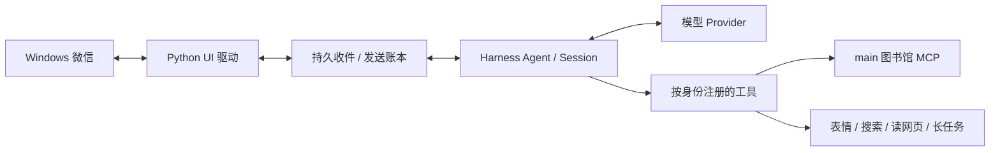

<div align="center">

# 小千微信 · Harness Native

**把 AI 聊天搭子「小千」接进 Windows 微信，模型、会话和工具全部交给 Harness 原生管理。**

</div>

## 这是什么

小千是一个住在微信里的 AI 聊天搭子。这个仓库是它的 **Harness 原生版**：

- **Harness**（DeepSeek Harness `dsh`）负责模型调用、每个聊天的持久会话和工具注册；
- **微信**只是消息的进出口；
- 一个**独立的 Python 驱动**专门操作微信桌面窗口（读消息、打字、点发送）。

旧版里那套独立 Brain、总调度 worker 和一次性 headless 转发都已经去掉，模型只在一个地方被调度。

> 这是**只含源码的公开快照**，不含任何聊天记录、人格、记忆库、凭据或日志。基础提交记录在 [`SOURCE.json`](SOURCE.json)。
> 代码能跑测试 ≠ 已经在你的机器上和真实微信跑通，部署后请自己验收。

## 小千全家桶

| 仓库 | 是什么 |
|---|---|
| **小千微信 · Harness Native**（当前） | 小千本体：微信桥接、会话、工具、权限 |
| [小千部署 Skill](https://github.com/AnthonyZZH/xiaoqian-deploy-skill) | 把本仓库部署到 Windows 桌面的完整流程：安装、升级、迁移、健康检查、回退 |
| [她的图书馆](https://github.com/AnthonyZZH/ai-memory-public) | 多个 AI 共用的长期记忆库（basic-memory + MCP），小千的 main 图书馆就接这里 |

## 架构



几个关键设计：

- **一个聊天 = 一个持久 Session**，重启后用原生 `resumeSessionId` 接着聊。
- **先落盘再确认**：消息先写进账本再 ACK，按会话保存稳定的消息身份，切换窗口不会把旧消息当成新消息。
- **UI 单线程**：桌面操作串行；模型推理、下载和后台任务不占 UI 队列。
- **不乱重发**：每次发送都有固定 operation ID，结果不明就标 `unknown`，绝不自动补发；单条 unknown 不会卡死整个会话。
- **权限写在代码里**：主人身份、Agent 绑定、群里能用什么工具，都由程序强制，不靠模型自觉。群消息、网页和文档里的文字都拿不到主人权限。

## 功能一览

✅ 可用　⚠️ 部分可用或默认关闭　❌ 未实现

| | 功能 | 说明 |
|---|---|---|
| ✅ | 主人私聊、指定群聊 | 每个会话独立；群里能接话，可叫停、少说、恢复。只有配置过的群会开放 |
| ✅ | 人格 | 每个会话单独加载人格，动态拼系统提示。仓库里不附原人格 |
| ✅ | 防重复、断点恢复 | 按会话的有序快照 + ACK + 发送账本；拿不准时延后识别，不按正文硬去重 |
| ✅ | 表情库 | 存原始字节，有审核、描述和标签检索；旧库可无损迁移 |
| ✅ | 网图入库 | 仅限主人；检查重定向和 IP，有大小和时长上限，新图先进待审核 |
| ✅ | 搜索、读网页正文 | 自带 Bing / DuckDuckGo 搜索和网页正文读取。超时、限流、付费墙、验证码会如实报错，不绕过 |
| ✅ | main 图书馆 | 仅限主人，通过 MCP 检索、读取，写入有约束；固定 main 项目，私密库不会接给社交 Agent |
| ✅ | 长期记忆 | 当前会话、带证据的聊天记忆、图书馆三层分开存；没确认送达的不会记成「已发送」 |
| ✅ | 主动找你聊 | 主人活跃时段每 18–32 分钟随机检查一次，低谷时段 3–7 分钟；睡觉优先，过期不补发，模型可以选择不说话。群里默认关闭 |
| ✅ | 长任务 | 立即返回 task ID，后台跑；可查进度、取消、看结果，重启后自动对账，状态不明的任务不会自动重跑 |
| ✅ | 项目文件 | 只能读写指定工作目录，原子写入带备份，支持 list / stat / sha256 |
| ✅ | API 余额 | 只查官方 DeepSeek 的余额，只读；转发商的 key 不会发给官方接口 |
| ⚠️ | 插件 / MCP 管理 | 能完整列出插件，已修好 undefined 字段导致的序列化错误；安装和启用的微信端确认流程、市场请求超时**还没修完** |
| ⚠️ | 微信附件 | TXT / DOCX 能解析，但从微信文件卡片下载这一步还没打通 |
| ⚠️ | 动图 | 能保留 GIF / APNG / WebP 原文件；还不能自动抓取微信里收到的原动图 |
| ⚠️ | 上下文轮换 | 代码已有，**自动轮换默认关闭** |
| ⚠️ | 生图、其他模型 | 可选，不配置就不可用 |
| ✅ | 任意 shell | 已认证主人私聊可在明确批准后启用 `owner_powershell`；模板默认关闭。保留原生输入来源、精确参数、超时/取消和 Job 回收校验。它使用现有宿主身份，Job 并非 OS 沙箱。见[接入说明](docs/owner-shell-origin.md) |
| ❌ | macOS | 没有 Mac 版驱动，也没在 Mac 上测过 |

> 💡 搜索不用付费 API，但把网页正文喂给模型照样耗 token；主动聊天和长任务也一样会产生模型费用。

## 目录结构

```text
src/       Harness 插件主体：会话、工具、权限、记忆、主动聊天
driver/    新一代驱动的 RPC 和客户端（还在隔离验收）
adapter/   新一代 Windows 微信适配器
compat/    与当前线上版本同代的驱动（生产用这个）
vendor/    独立模块，带各自的来源和许可说明
tools/     部署配置生成器、受控 worker
tests/     模拟消息、假驱动、原生接口契约测试
docs/      配置模板、来源说明
```

> ⚠️ `compat/` 驱动的身份数据**不能直接交给**新的 `driver/`，两代格式不同，需要单独做迁移验收。

## 运行环境

| 依赖 | 已验证版本 |
|---|---|
| Windows 微信 | 4.1 |
| Node.js | 24 |
| Python | 3.12（`uiautomation`、`comtypes`、`Pillow`，见 [`requirements-windows.txt`](requirements-windows.txt)） |
| DeepSeek Harness | `@deepseek-ai/dsh` `0.2.1-rc.4` |
| basic-memory（可选） | `0.24.1` |

**重要：Harness 必须跑在微信所在的那个已登录桌面会话里。** 通过 SSH 启动的进程在 Session 0，看不到微信窗口。云服务器上 RDP 断开、锁屏、注销的表现各不相同，部署后要实际测一遍。

## 快速开始

想让 Codex 帮你一步步部署，可以直接用 [小千部署 Skill](https://github.com/AnthonyZZH/xiaoqian-deploy-skill)。手动部署按下面走。

下面的路径只是示例，换成你自己的。**聊天、人格、记忆、日志等所有运行数据都放在仓库目录外面。**

### 1. 安装依赖

```powershell
$Repo     = 'C:\Apps\xiaoqian-weixin'
$HostRoot = 'C:\Apps\Harness'
$Private  = 'C:\AppData\Xiaoqian'
$Python   = 'C:\Python312\python.exe'

New-Item -ItemType Directory -Force $HostRoot, $Private | Out-Null
& $Python -m venv "$Private\venv"
& "$Private\venv\Scripts\python.exe" -m pip install -r "$Repo\requirements-windows.txt"
npm install --prefix $HostRoot @deepseek-ai/dsh@0.2.1-rc.4 @deepseek-ai/dsh-tools@0.2.1-rc.4
```

### 2. 配置模型

在 Harness 的 Web profile 里配好模型 provider。生成器默认用 `deepseek-official` / `deepseek-flash`，名字要和你实际配置的一致。API key 交给 Harness 的环境去管，**别写进仓库、补丁文件或日志**。

### 3. 登录微信，确认主人

在桌面会话里打开并登录微信，确认主人私聊窗口的标题。重名的话要额外核对，拿不准就别发。

### 4. 生成配置补丁

```powershell
node "$Repo\tools\render-owner-deployment.mjs" `
  --state-root "$Private\state" `
  --python "$Private\venv\Scripts\python.exe" `
  --owner-title '主人的微信备注名' `
  --native-package-root "$HostRoot\node_modules\@deepseek-ai" `
  --adapter-root "$Repo\compat\adapter" `
  --driver-rpc "$Repo\compat\driver\bridge_rpc.py" `
  --output "$Private\wechat.patch.json"
```

生成的配置默认：**启动即暂停**、只有主人私聊、群里不主动说话、自动轮换关闭。输出文件已存在时会拒绝覆盖。

可选开关（都要显式打开，只开你已经部署好的）：

| 参数 | 作用 | 额外要求 |
|---|---|---|
| `--group-title '群名'` | 开放一个群 | 群名需确认无误 |
| `--main-library true` | 接 main 图书馆 | 本机 `127.0.0.1:8767/mcp` 已运行 basic-memory |
| `--owner-wake true` | 主动找主人聊天 | — |
| `--owner-management true` | 插件 / MCP 管理 | — |
| `--balance true` | 查 DeepSeek 余额 | 官方 provider |
| `--long-tasks true` | 长任务 | `--task-root <绝对路径>` |
| `--owner-files true` | 项目文件读写 | `--work-root <独立目录>` + `--base-python <路径>` |
| `--remote-media true` | 网图入库 | `--base-python <路径>` + `--site-packages <路径>` |

### 5. 启动

在微信所在的桌面会话里运行：

```powershell
$env:DSH_HOME = "$Private\harness-home"
node "$HostRoot\node_modules\@deepseek-ai\dsh\lib\bin.js" `
  --profile web --patch "$Private\wechat.patch.json"
```

启动后是暂停状态。先确认 Agent、人格、主人专属工具和驱动都正常，再从管理入口恢复。首次运行只会记录历史消息作为基线，不会回复旧消息。**新旧两套微信控制程序不要同时跑。**

## main 图书馆（可选）

本仓库只有客户端，不带 [basic-memory](https://github.com/basicmachines-co/basic-memory) 服务和任何笔记。图书馆本身的搭建方法、目录模板和多 AI 共用配置见 [她的图书馆](https://github.com/AnthonyZZH/ai-memory-public)。

- 按图书馆仓库的说明部署 basic-memory，**只监听本机** `127.0.0.1:8767/mcp`，固定用 main 项目。别为了连上就开到公网。
- health 检查用库里真实存在的笔记做锚点；锚点不存在是配置问题，不代表记忆丢了。
- 写入时校验目标和校验和，写完读回确认；结果不明时不盲目重试，也不覆盖已有笔记。
- 群聊和其他私聊不会继承 main，更不会接到私密库。

## 数据要分开保存

以下内容都**不属于代码**，升级、迁移时要单独备份：

Harness home 与 provider 配置 · 桥接 `stateDir`（含 `bridge/bridge.json` 会话映射）· 驱动 SQLite（ACK、快照、unknown）· 主动聊天 SQLite · 每会话人格 · 表情原文件与索引 · 证据记忆 · 长任务账本 · 轮换账本 · main 图书馆

`owner_files` 的工作目录必须是独立目录，不能指向 Harness home、凭据、会话数据或私密库。

## ⚠️ 换机器 / 换桌面前必读

换服务器、换桌面会话或换驱动后，即使账本完整，微信 UI 的元素 ID 也可能全部重新分配，旧消息可能被认成新消息。

**迁移后必须保持暂停**，先验证消息身份基线，确认安全后再恢复自动回复。不要用清账本、重放历史或按正文去重来绕过这一步。fake 测试通过不等于迁移验收通过。

## 升级与回滚

**升级**

1. 备份当前代码（Git bundle）、启动入口和私有配置。
2. 暂停接收，等正在发送的消息和正在进行的 Agent 回合走完。
3. 停写后一致性备份 bridge、SQLite（含 WAL）、会话、人格、媒体、任务状态，记下哈希。
4. 把新版本放到**另一个目录**，确认配置、模型别名、Python、驱动都对得上。
5. 启动后核对：进程所在 Session、源码指纹、暂停状态、会话 ID、人格提示词、工具清单、群隔离、定时状态。进程活着不代表微信能用。
6. 确认无误后再改启动入口。实测只对明确同意的会话发消息，不要群发测试。

**回滚**

回到上一个可用的 Harness-native 版本，不回到旧外壳。新版本如果已经收发过消息，**不能直接用旧备份整库覆盖**，否则会丢 ACK 或重复发送；先对账，unknown 原样保留。不要强删 Session 写锁，先查清是谁持有。


## Read 终态诊断修复（已部署组件，慢读根因未解决）

兼容驱动现在为每次 read 保留可关联的 Node/Python 元数据终态：成功、超时、异常、进程退出及关闭取消都有明确结果。它补齐了“请求已消耗，却没有结束证据”的诊断缺口；**不是 UI 提速补丁，也不是发送确认或历史消息重放机制**。

- Python worker/client 和 Node JSONL transport 使用关联 request ID，记录阶段、耗时、worker 代际及可取得的退出码；不记录正文、群成员名、人格、命令参数或原始异常文本。
- 超时后的下一代 worker 可以继续接收新 read；关闭时在途和排队 read 的 future 会结束。诊断文件写入失败会计数，不得让业务 future 挂住。
- 既有群 `driver.call` 包装仍保留；无法追溯其队列起点时，`queue_ms` 明确为 null，不伪造为 0。
- 收件落盘/ACK、发送 operation/unknown、主人和群权限、read/send budget、UI动作均不改变。日志中 read success 只表示读取完成，不等于 Agent 已回复或微信收件端已看到。
- 服务器已观察到 6 次自然 read 的 Node/Python 成对终态；成功仍约 **10.2–11.6秒**，另有 `backend_read_wait` 到约12秒超时、worker退出后下一代成功。**慢读、冷加载或控件遍历的具体耗时根因尚未解决**。

日志在私有 driver state 目录下生成，绝不要提交到仓库。状态字段、保留策略、16项离线回归和精确命令见 [Read终态诊断说明](docs/READ-OUTCOMES.md)。公开仓库只收源码、通用合成夹具和脱敏状态说明，不含生产proof、样本、聊天或运行配置。整套公开快照仍须逐项部署验收。

## 常见问题

| 现象 | 先查这里 |
|---|---|
| SSH 能启动但操作不了微信 | 进程是不是和微信在同一个桌面会话，别在 Session 0 里反复启动 |
| 人格为空或风格不对 | 实际 `stateDir` 路径、目录是否套了两层、当前 Agent 实际生效的提示词 |
| 表情库是空的 | 旧库路径和 schema，先做无损迁移，别让用户重传 |
| 同一条消息回了好几次 | 切窗后身份是否稳定、快照和 ACK、是否把自己发出的消息读回来了 |
| 输入框有草稿没发出去 | 分清是点发送前失败还是点了之后结果不明；别盲点发送，也别清掉用户手打的草稿 |
| 搜到了标题没有正文 | 用读网页工具，搜索摘要不是全文 |
| 不主动找我聊 | 总开关、私聊/群开关、睡眠截止时间、时区、`next_due`、决策超时 |
| 插件一直等确认 | Web profile 的插件管理和市场是否注入、确认状态；别反复点或放开全局权限 |
| 查不到余额 | 是不是官方 provider、认证是否同源、rc.4 包路径 |

提 issue 时只贴脱敏后的版本号、时间、状态、operation ID 和最小报错。**Harness 日志里可能有 Web token，不要整份贴出来。**

## 测试

```powershell
Set-Location $Repo
$env:XQ_TEST_PYTHON     = "$Private\venv\Scripts\python.exe"
$env:XQ_COMPAT_RPC_PATH = "$Repo\compat\driver\bridge_rpc.py"
npm run check
npm test
```

测试用的全是模拟消息和假驱动，覆盖权限隔离、媒体格式、消息身份和原生接口契约。部分测试依赖 rc.4 包的位置，跑之前看一下对应测试文件。测试通过不代表真实微信可用；CI 里也不要放真实 key、记忆库或聊天记录。

## 关于 macOS

核心逻辑（会话、权限、媒体、记忆）尽量做成跨平台，但**微信操作目前只有 Windows 驱动**。在非 Windows 系统上真实驱动会直接拒绝启动，假驱动可以跑测试。要支持 Mac，需要写一个遵守同样 RPC / ACK / operation 语义的 macOS 驱动，再重新验收。

## 来源与许可

见 [NOTICE.md](NOTICE.md)、[docs/PROVENANCE.md](docs/PROVENANCE.md) 和 `vendor/` 下各模块自带的声明。

本仓库**没有统一的根许可证**。公开可见不等于可以随意复用；各部分按各自的许可和授权处理。某个 QQ 子插件的 MIT 许可只覆盖那个子插件，本仓库也不包含 QQ 实现。

## 主人私聊页面锚点恢复

兼容驱动已归档经过 Windows 服务器验证的最新页恢复机制，避免整页无顺序重叠后永久停止接收。保留原 ACK、会话及发送 unknown 状态；停滞期间历史消息未补投。接入配置、恢复步骤、公开副本差异及 12 项 mock 验证见 [恢复说明](docs/owner-anchor-recovery.md)。


Recent release: [independent owner tasks and trusted billing origin](docs/isolated-task-release.md). Runtime integration is deployed; real owner task submission, cancellation/result delivery and deployed crash reconciliation remain natural-use acceptance. Automatic rotation stays off.

Maintenance: [SDK task input context compatibility](docs/TASK-INPUT-SDK-COMPAT.md) is deployed. It preserves rejection of genuinely queued extra input; it does not enable the separate plugin/MCP approval transport.


## v6b source candidate

See [source closeout and remaining acceptance](docs/V6B-CLOSEOUT.md) for group policy lifecycle, persistent draft protection, compatibility-driver continuity, approval/status updates and Windows deployment limits. This candidate has not itself been deployed as a complete release.

## Read 阶段审计与切窗标题检查

在上述终态证据之上，新增现有 read 内部各阶段的元数据计时；切窗等待只读标题，正式 validate 仍每次重新检查私聊/群类型，不缓存权限判断。公开适配保留既有发送、附件、草稿和 owner 参数化校验。

安装后观察仍有约 **6.69–11.95 秒**的读取及 cutoff，不能称为慢读根治，也不代表每条自然消息都已回复。本次不加预算、不增加 UI 调用、不包含可选计量端口。3 个阶段审计与 5 个实际方法离线测试覆盖记录与校验保持；真实 UI 性能、附件和收件端验收仍需各自证据。详见 [阶段说明与复现](docs/READ-PHASES.md)。

## 原生 UI 查询与 worker 回收跟进

已同步同窗口、同谓词的 UIAutomation 原生查询与歧义/不支持回退；保留每次真实目标和类型校验，只删除 read 自带校验前的相邻重复调用。Windows worker 使用既有环境直接启动实际进程并校验 PID，确认原进程退出后才解除 stop_unconfirmed 隔离。

固定生产证据截至 **2026-10-31 21:28 UTC**：最近 **8 次私聊/群聊交替 read 终态均成功，约 2.48–3.00 秒**，原 Host 未重启。这是一段短样本，不是永久延迟保证、消息收件确认或所有 cutoff 已根治；前文较慢数据是历史安装阶段。公开树保留发送、附件、草稿与 owner 参数化边界，未打包现场临时入口或原始运行 proof。

**附件下载仍未启用，计量仍撤回，不能据此称全项目完成。** 具体实现、回退、worker 退出约束和离线复现见 [原生查询与回收说明](docs/READ-NATIVE.md)。

本次公开候选在服务器隔离目录完成 **43 个 Python + 9 个 Node 离线测试，共 52 项，0 失败、0 跳过**；另通过入口语法检查。其中包含 Windows 临时 venv 的真实 worker PID/读/退出测试，无包下载、真实微信、模型调用或对外发送。
