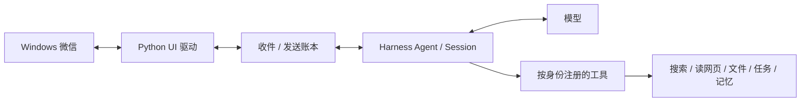

<div align="center">

# 小千微信 · Harness Native

**一个住在 Windows 微信里的 AI 私人助理。**

</div>

小千在微信里和你聊天，也替你办事：联网搜索、读网页和文件、看图、在后台跑多步任务、记住长期的事、主动找你说话。模型、会话和工具由 DeepSeek Harness（`dsh`）管理，微信只是消息的进出口。

> 这是**只含源码的公开快照**：不含聊天记录、人格、记忆库、密钥或日志。
> 测试通过不等于已经在你的机器和真实微信上跑通，部署后请自己验收。

## 目录

- [她能做什么](#她能做什么)
- [怎么工作的](#怎么工作的)
- [运行环境](#运行环境)
- [快速开始](#快速开始)
- [手机控制面板](#手机控制面板)
- [联网搜索](#联网搜索)
- [后台任务](#后台任务)
- [数据、迁移、升级](#数据迁移升级)
- [常见问题](#常见问题)
- [测试](#测试)
- [已知限制](#已知限制)
- [相关仓库、来源与许可](#相关仓库来源与许可)

## 她能做什么

✅ 可用　⚠️ 需要额外配置或有限制　❌ 没有

| | 功能 | 说明 |
|---|---|---|
| ✅ | 主人私聊、指定群聊 | 每个聊天一个独立的持久会话。群里能接话，主人可以让她停、少说、恢复 |
| ✅ | 群改名自动跟随 | 群或好友改了显示名，她自己换成新名字继续工作，并私聊告诉主人 |
| ✅ | 联网搜索、读网页 | 三个搜索引擎同时查，结果带摘要和日期；读网页只取正文。见[联网搜索](#联网搜索) |
| ✅ | 后台任务 | 交代一件要花时间的事，她先回「收到」再去做；互不依赖的步骤并行。见[后台任务](#后台任务) |
| ✅ | 手机控制面板 | 浏览器里看任务进度、暂停恢复、切换模型、重启。见[手机控制面板](#手机控制面板) |
| ✅ | 看图 | 自动打开大图取原图交给模型；动图只看一帧 |
| ⚠️ | 读文件 | 已登记的 TXT、DOCX、PDF 等聊天文件可以读；新文件的自动接收还在验收 |
| ✅ | 长期记忆 | 当前会话、带原话证据的聊天记忆、外接图书馆（basic-memory，可选）三层分开 |
| ⚠️ | 会话自动轮换 | 上下文快满时写摘要、换新会话，旧会话归档后可回查。默认关闭，配置 `rotationLite.enabled` 开启 |
| ✅ | 主动找你聊 | 按时段随机检查，她可以选择不说话；睡觉时间不打扰 |
| ✅ | 表情库 | 存原文件，有审核、描述和标签检索 |
| ✅ | 查 API 余额 | 只读，只查官方 DeepSeek |
| ⚠️ | 换模型 | 面板里切换 DeepSeek 或任何 OpenAI 兼容接口（包括本机跑的模型） |
| ⚠️ | 画图 | 接 OpenAI 兼容的图片接口或 Stable Diffusion WebUI，配置后可用 |
| ⚠️ | 电脑操作 | 主人私聊里可以执行 PowerShell、读写指定目录的文件；默认关闭，需要明确批准 |
| ⚠️ | 插件 / MCP 管理 | 能列出和查看；安装确认流程未完成 |
| ❌ | macOS | 只有 Windows 驱动 |

权限写在代码里，不靠模型自觉：**群聊永远拿不到主人的工具和私有记忆**；群消息、网页、文档里的文字都不能给任何人授权。

## 怎么工作的



- **一个聊天一个会话**，重启后接着聊。
- **先落盘再确认**：收到的消息先写进账本再处理，切换窗口不会把旧消息当成新消息。
- **不重复发送**：每次发送有固定编号，结果不明就标 `unknown`，永不自动补发。
- **桌面操作单线程**：只有读消息、打字、点发送排队；模型推理和后台任务不占这个队列。

```text
src/       Harness 插件主体：会话、工具、权限、记忆、主动聊天、面板
vendor/    独立模块：搜索与网页读取、任务引擎、图书馆适配、驱动等
compat/    当前线上使用的微信驱动
driver/    adapter/   新一代驱动（还在验收，身份数据与 compat 不通用）
tools/     配置生成器、受控 worker
tests/     模拟消息、假驱动、接口契约测试
docs/      各功能的详细说明
```

## 运行环境

| 依赖 | 已验证版本 |
|---|---|
| Windows 微信 | 4.1 |
| Node.js | 24 |
| Python | 3.12，依赖见 [`requirements-windows.txt`](requirements-windows.txt) |
| DeepSeek Harness | `@deepseek-ai/dsh` `0.2.1-rc.4` |
| basic-memory（可选） | `0.24.1` |

**Harness 必须和微信跑在同一个已登录的桌面会话里。** 通过 SSH 启动的进程在 Session 0，看不到微信窗口。云服务器上断开远程桌面、锁屏之后的表现各不相同，部署后要实际测一遍。

## 快速开始

想让 AI 一步步带你部署，用 [小千部署 Skill](https://github.com/AnthonyZZH/xiaoqian-deploy-skill)。手动部署如下，路径都是示例。**聊天、人格、记忆、日志等运行数据一律放在仓库目录之外。**

### 1. 安装依赖

```powershell
$Repo     = 'C:\Apps\xiaoqian-weixin'
$HostRoot = 'C:\Apps\Harness'
$Private  = 'C:\AppData\Xiaoqian'
$Python   = 'C:\Python312\python.exe'

New-Item -ItemType Directory -Force $HostRoot, $Private | Out-Null
& $Python -m venv "$Private\venv"
& "$Private\venv\Scripts\python.exe" -m pip install -r "$Repo\requirements-windows.txt"
npm install --prefix $HostRoot @deepseek-ai/dsh@0.2.1-rc.4 @deepseek-ai/dsh-tools@0.2.1-rc.4
```

### 2. 配置模型

在 Harness 里配好模型。默认用 `deepseek-official` / `deepseek-flash`。密钥交给 Harness 的环境管理，**不要写进仓库、配置补丁或日志**。

### 3. 登录微信

在桌面会话里打开并登录微信，确认主人私聊窗口的标题。有重名时要额外核对。

### 4. 生成配置

```powershell
node "$Repo\tools\render-owner-deployment.mjs" `
  --state-root "$Private\state" `
  --python "$Private\venv\Scripts\python.exe" `
  --owner-title '主人的微信备注名' `
  --native-package-root "$HostRoot\node_modules\@deepseek-ai" `
  --adapter-root "$Repo\compat\adapter" `
  --driver-rpc "$Repo\compat\driver\bridge_rpc.py" `
  --output "$Private\wechat.patch.json"
```

生成的配置默认**启动即暂停**、只有主人私聊、群里不主动说话。可选开关都要显式打开：

| 参数 | 作用 | 额外要求 |
|---|---|---|
| `--group-title '群名'` | 开放一个群 | 群名确认无误 |
| `--main-library true` | 接图书馆 | 本机 `127.0.0.1:8767/mcp` 已运行 basic-memory |
| `--owner-wake true` | 主动找主人聊天 | — |
| `--owner-management true` | 插件 / MCP 管理 | — |
| `--balance true` | 查余额 | 官方 DeepSeek |
| `--long-tasks true` | 长任务 | `--task-root <绝对路径>` |
| `--owner-files true` | 项目文件读写 | `--work-root <独立目录>` + `--base-python <路径>` |
| `--remote-media true` | 网图入库 | `--base-python <路径>` + `--site-packages <路径>` |

### 5. 启动

在微信所在的桌面会话里运行：

```powershell
$env:DSH_HOME = "$Private\harness-home"
node "$HostRoot\node_modules\@deepseek-ai\dsh\lib\bin.js" `
  --profile web --patch "$Private\wechat.patch.json"
```

启动后是暂停状态。确认会话、人格、工具和驱动都正常，再恢复。首次运行只把历史消息记为基线，不会回复旧消息。**不要同时运行两套控制微信的程序。**

## 手机控制面板

在桥接配置里打开后，小千会在本机起一个小网页（默认 `127.0.0.1:8790`）：

```json
"ownerTasks": {
  "enabled": true,
  "panel": {
    "enabled": true,
    "host": "0.0.0.0",
    "port": 8790,
    "publicUrl": "http://你的地址:8790",
    "control": {
      "enabled": true,
      "settingsFile": "<私有目录>\\panel-settings.json",
      "patchFile": "<私有目录>\\wechat.patch.json",
      "restartScript": "<你的重启脚本>.ps1"
    }
  }
}
```

- 地址里带一段随机口令（`http://地址:端口/<口令>/`），问她「面板地址」她会私聊发给你。
- 不配 `control` 时面板只读：看任务、每一步的状态和产物。
- 配了 `control` 才能操作：暂停和恢复、取消和重试任务、切换聊天模型、配置画图、重启。
- **密钥默认只读。** 面板只显示每个密钥「已设置 / 未设置」，不能输入也读不出来。密钥放在这台电脑的环境变量里：`XQ_DEEPSEEK_API_KEY`、`XQ_CUSTOM_LLM_API_KEY`、`XQ_DRAW_API_KEY`。
- 面板是明文 HTTP。放到公网时口令就是唯一的门，不要把地址发给别人；有条件就放在内网或反向代理后面。

## 联网搜索

配置里 `searchEnabled: true` 时可用（配置生成器默认打开）。不需要付费接口。

- **`owner_search`**：一次最多 4 个搜索词，必应国内、必应国际、搜狗同时查，结果合并去重。每条带摘要、日期和来源引擎。`freshness` 可以只要最近一天、一周、一月或一年的结果。
- 搜索引擎会无视 `site:` 和时间筛选，偶尔返回整页无关结果，所以**站点、时间和相关性都在本地再过滤一遍**，并在返回里说明过滤了什么、结果是否偏旧、是否和上一次搜索完全相同。
- **`owner_fetch`**：只返回网页正文。长文分段续读；填 `focus` 就只返回提到这些词的段落；一次可读 3 个网址。靠 JavaScript 渲染的页面和验证墙会如实标出来。
- 遇到人机验证就停，不重试、不绕过。搜狗每次调用只发一个请求，遇验证后暂停使用 30 分钟。
- 读网页只连公网地址，每一跳都重新解析并校验，防止被引到内网。
- 非主人的聊天如果开了搜索，用的是同一套引擎，但只有一个搜索词、五条结果。

这三个引擎是在一台中国大陆的服务器上实测可达的；DuckDuckGo、Brave 在那里连不上，百度会直接要求验证。换个网络环境情况可能不同，引擎表在 [`vendor/owner-tools/web_search.py`](vendor/owner-tools/web_search.py) 开头。

## 后台任务

主人说「后台帮我做……」时，她调用 `task_start`：

1. 把事情拆成步骤，写明哪一步依赖哪一步。
2. **先回一句「收到」**，再开工。
3. 互不依赖的步骤并行执行（全局最多 3 个执行者），每一步的产物存成文件。
4. 全部完成后汇总，通知主人一次。

执行期间照常聊天，可以用自然语言问进度、取消、重试失败的步骤、取结果。任务状态存在 SQLite 里，进度来自真实的执行事件。重启时正在跑的步骤标记为失败，**不会自动重跑**，由主人决定是否重试。

## 数据、迁移、升级

这些都**不属于代码**，升级和迁移时要单独备份：

Harness home 与模型配置 · 桥接状态目录（会话映射、收发账本）· 驱动 SQLite · 每个会话的人格 · 表情原文件与索引 · 证据记忆 · 任务账本 · 轮换账本 · 图书馆

**换机器、换桌面会话或换驱动之后**，微信界面元素的编号可能全部重排，旧消息可能被认成新消息。迁移后必须保持暂停，先验证消息身份基线，再恢复自动回复。不要用清账本、重放历史或按正文去重来绕过这一步。

**升级**：暂停 → 等正在进行的回合结束 → 停写后备份状态并记下哈希 → 新版本放到另一个目录 → 启动后核对桌面会话、会话编号、人格、工具清单、群隔离 → 确认无误再切换入口。

**回滚**：回到上一个可用版本。新版本如果已经收发过消息，不能用旧备份整库覆盖，否则会丢确认记录或重复发送；先对账，`unknown` 原样保留。

## 常见问题

| 现象 | 先查这里 |
|---|---|
| SSH 能启动但操作不了微信 | 进程是否和微信在同一个桌面会话 |
| 人格为空或风格不对 | 实际的状态目录路径、当前会话生效的系统提示 |
| 同一条消息回了好几次 | 切换窗口后消息身份是否稳定、是否把自己发的消息读回来了 |
| 输入框有草稿没发出去 | 分清是点发送前失败还是点了之后结果不明；不要盲点发送 |
| 群改名后她不说话了 | 等几轮读取，她会自动跟随；跟不上时会私聊主人 |
| 搜索结果偏旧 | 看返回里的 `notes` 和每条的 `date`；搜不到不等于没有 |
| 网页读出来是空的 | 看 `render_required`，这类页面换一个来源 |
| 不主动找我聊 | 总开关、睡眠时间、时区、下一次检查时间 |
| 面板打不开 | 端口是否放行、地址里的口令是否完整 |
| 查不到余额 | 是否官方 DeepSeek、认证是否同源 |

提 issue 时只贴脱敏后的版本号、时间、状态码和最小报错。**Harness 日志里可能有访问口令，不要整份贴。**

## 测试

```powershell
Set-Location $Repo
$env:XQ_TEST_PYTHON     = "$Private\venv\Scripts\python.exe"
$env:XQ_COMPAT_RPC_PATH = "$Repo\compat\driver\bridge_rpc.py"
npm run check
npm test
```

测试只用模拟消息和假驱动，不联网、不碰真实微信。一部分测试需要本机装好 rc.4 的 Harness 包和 Python 依赖（如 Pillow），缺了会失败，不代表代码有问题。

## 已知限制

- 只支持 Windows；核心逻辑尽量跨平台，但没有 macOS 驱动。
- 动图只分析一帧；还不能自动抓取收到的原动图。
- 靠 JavaScript 渲染的网页读不到正文，只能识别并提示。
- 新文件的自动接收还在离线验收阶段。
- 插件 / MCP 的安装确认流程没有做完。
- 新一代驱动（`driver/`、`adapter/`）还没有替换线上的 `compat/`。

各功能的边界、验收证据和历史状态说明在 [`docs/`](docs/)；重写前的 README（按时间累积的状态记录）保存在 [`docs/STATUS-ARCHIVE.md`](docs/STATUS-ARCHIVE.md)。

## 相关仓库、来源与许可

| 仓库 | 是什么 |
|---|---|
| **小千微信 · Harness Native**（本仓库） | 小千本体 |
| [小千部署 Skill](https://github.com/AnthonyZZH/xiaoqian-deploy-skill) | 安装、升级、迁移、健康检查、回退的完整流程 |
| [她的图书馆](https://github.com/AnthonyZZH/ai-memory-public) | 多个 AI 共用的长期记忆库（basic-memory + MCP） |

来源说明见 [NOTICE.md](NOTICE.md)、[docs/PROVENANCE.md](docs/PROVENANCE.md) 和 `vendor/` 下各模块自带的声明。基础提交记录在 [`SOURCE.json`](SOURCE.json)。

本仓库**没有统一的根许可证**。公开可见不等于可以随意复用，各部分按各自的许可和授权处理。
